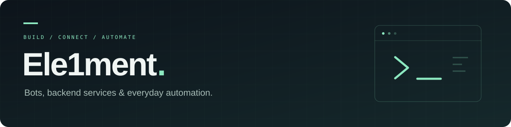

### Hey, I'm Element 👋

I work on Telegram bots, backend services and automation — connecting APIs, payments and the tools behind everyday workflows.

**Currently focused on**

- Telegram bots and web apps for digital services.
- API integrations, payments and automated order handling.
- License management and services running on Linux with Docker.

### Stack in my projects

`Python` · `Go` · `Flask` · `PostgreSQL` · `SQLite` · `Docker` · `Linux` · `Nginx`

### Earlier web projects

[Web storefront](https://github.com/Ele1ment/Sait_Shop) · [Music website](https://github.com/Ele1ment/The-Music-Website)

---

Most of my current application work lives in private repositories.
